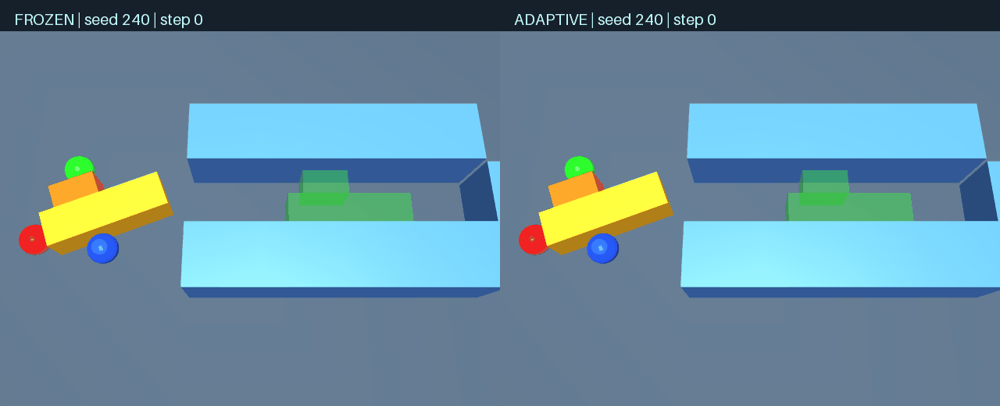

# Adaptive Contact Geometry for Peg-in-Hole MPC

A small, simulation-only study of **where contact geometry is evaluated inside
model predictive control**. Three independently actuated spherical fingertips
insert an asymmetric, two-box peg into a narrow slot in MuJoCo. A smooth,
ContactSDF-inspired geometry model feeds an explicit complementarity-free
(CF) contact response.

The two controllers share the same geometry representation, response, cost,
solver, and initial conditions. Their difference is one choice:

```text
Frozen:    q[k+1] = F_CF(q[k], u[k], G(q_measured))
Adaptive:  q[k+1] = F_CF(q[k], u[k], G(q[k]))
```

Here, “adaptive” means evaluating known geometry at predicted states. It does
not mean learning geometry or identifying unknown physical parameters online.
The composition builds on existing work; **no claim of a new contact law or
the first differentiable-geometry/CF combination is made**.
[Related work and search limitations](docs/related_work.md).



*A rollout generated by this implementation. Left: frozen; right: adaptive.
Frames are aligned by simulation step, with the final pose held after a run
ends. This is one illustrative case, not an estimate of success rate.*

## What this project contributes

1. **A concrete diagnosis.** Within a prediction horizon, freezing gaps and
   contact Jacobians can leave the optimizer reasoning about the geometry of
   the measured pose while the predicted peg approaches or turns into the slot.
   The experiment isolates this choice instead of changing several controller
   components together.
2. **Task-specific smooth geometry.** Implement support-plane log-sum-exp
   fields for boxes, a smooth union for the keyed peg, and smooth aggregation
   over surface samples. Eleven fixed potential contact pairs cover the two
   peg parts against the table and three walls, plus three fingertip contacts.
3. **Integration with the explicit CF response.** Evaluate gaps, normals, and
   friction rows symbolically at each predicted state in CasADi. Use full
   separation with its matching velocity Jacobian, preserve the response and
   quaternion conventions, and solve the resulting direct multiple-shooting
   program using IPOPT. Contact forces require no nested solver or additional
   optimization variables.
4. **A paired evaluation.** Compare frozen and adaptive geometry on identical
   seeded initial conditions, using a sustained physical success criterion.
   Keep failures in the denominator; report solver status, planning time, and
   contact penetration alongside success. Provide tests, a procedural scene,
   and scripts to generate and analyze every trial within this repository.

The learning value is implementing and testing this complete modeling/control
loop. The robot is an abstract three-fingertip system, not a deployed dexterous
hand. There is no training stage or hardware result in this repository.

## Run

Use Python 3.11. The tested direct dependencies are pinned. The main experiment
runs headlessly and needs no GPU or graphics context; GIF rendering needs an
OpenGL backend. No external repositories, meshes, checkpoints, credentials, or
network calls are needed at runtime.

```bash
python3.11 -m venv .venv
source .venv/bin/activate
python -m pip install -r requirements.txt

# Five-step execution check; too short to assess task success.
python run.py --seeds 240 --max-steps 5 --output outputs/smoke

# A complete paired demonstration; each arm allows up to 600 steps.
python run.py --seeds 240 --output outputs/demo
python render.py outputs/demo --seed 240 --output outputs/demo.gif

# Evaluate both controllers on 50 paired initial conditions.
# STOP is exclusive. This runs 100 trajectories and can take tens of minutes.
python run.py --seed-range 240 290 --output outputs/evaluation
python analyze.py outputs/evaluation/summary.json \
  --output outputs/evaluation/analysis.json \
  --plot outputs/evaluation/success.png

python -m pytest -q
```

Choose a fresh output path for each run; existing output directories are never
overwritten. Each run saves the protocol, package versions, source hashes,
per-step CSVs, state/action NPZs, and trial summaries. `progress.json` is partial
progress; only `summary.json` indicates the requested run set completed.
The paired analysis reads the completed summary, rejects missing/duplicate
arms, and checks declared seed coverage. It computes success rates, Wilson
intervals, paired outcomes, solver-success fractions, and planning-time
summaries from those runs. Do not pool results from different settings.

The tests check geometry derivatives, the CF response against a separate
numerical formula, equivalence of the two arms at horizon 1, geometry changes
at horizon 2, deterministic simulation, success thresholds, and complete
paired-result loading. They run without graphics or external datasets.

On macOS, if CasADi's IPOPT plugin reports a missing `libgfortran`, install
Homebrew GCC and expose its runtime before running the commands:

```bash
brew install gcc
export DYLD_LIBRARY_PATH="$(brew --prefix gcc)/lib/gcc/current${DYLD_LIBRARY_PATH:+:$DYLD_LIBRARY_PATH}"
```

On a headless Linux system with the corresponding EGL driver, rendering can
use `MUJOCO_GL=egl python render.py ...`. Linux execution is not yet validated
for this release; the tested platform is macOS arm64.

## Evaluation protocol and limits

Default horizon: 2; C-SDF sharpness: 800; CF SoftPlus sharpness: 100; maximum
600 controller steps. Initial yaw is uniform within ±24°, lateral offset
within ±3 mm, with a peg-local initial grasp. Seeds deterministically set the
same initial state for both arms.

Success requires **10 consecutive post-action states** satisfying all four:
peg x > 90 mm; position error < 12 mm; quaternion error
`1 - dot(q, q_target)^2 < 0.01`; minimum *reported MuJoCo peg–wall contact*
distance ≥ −0.5 mm. When no peg–wall contact is reported, this distance uses a
1 m sentinel; it is not a positive-clearance measurement. Transient penetration
outside the final hold is logged and may exceed 0.5 mm.

MuJoCo integrates at 2 ms for 10 substeps per action (20 ms simulated control
period). The surrogate uses a separate model step of 0.1 s. All finite IPOPT
iterates are executed, even when the solver reports failure; the status remains
in the logs. Workspace bounds are optimization constraints, not physical clamps.
The timing comparison includes the different states visited by each policy;
it does not isolate intrinsic graph cost. Simulated control periods do not
establish real-time execution.

The model assumes known shapes and full state. Its sampled smooth fields are
approximate contact gaps, not exact Euclidean signed distances. Potential
contact pairs are fixed; friction directions use task-specific constructions.
First-order predicted quaternions are not renormalized. This single task does
not establish generalization to other shapes, real hands, perception errors,
or long-horizon planning. [Equations and conventions](docs/method.md).

## Layout and attribution

```text
adaptive_mpc/   task, geometry, CF response, MPC, and MuJoCo execution
run.py         experiment runner
analyze.py     paired statistics and success plot
render.py      visualization of saved trajectories
tests/         derivative, controller, simulation, and analysis checks
docs/          method, related work, attribution, and demo
tools/         explicit-file release checker and archive builder
```

The algorithms are credited to Wanxin Jin's
[Complementarity-Free MPC](https://arxiv.org/abs/2408.07855) and Wen Yang and
Wanxin Jin's [ContactSDF](https://arxiv.org/abs/2408.09612).
This is an independent project and is not an official release by either team.
Source code and documentation authored for this project are provided under
[MIT](LICENSE); dependencies retain their own licenses.
[Sources and licensing](docs/provenance.md).

Before distributing a snapshot, run `python tools/check_release.py`.
To produce an archive from the explicit file list:
`python tools/check_release.py --archive dist/adaptive-contact-geometry-mpc.zip`.
It does not copy Git history, environments, generated experiment directories,
or files outside the release list.
